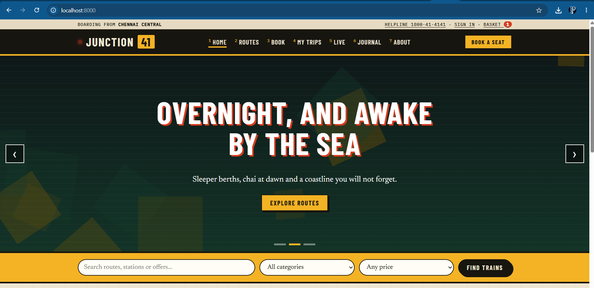
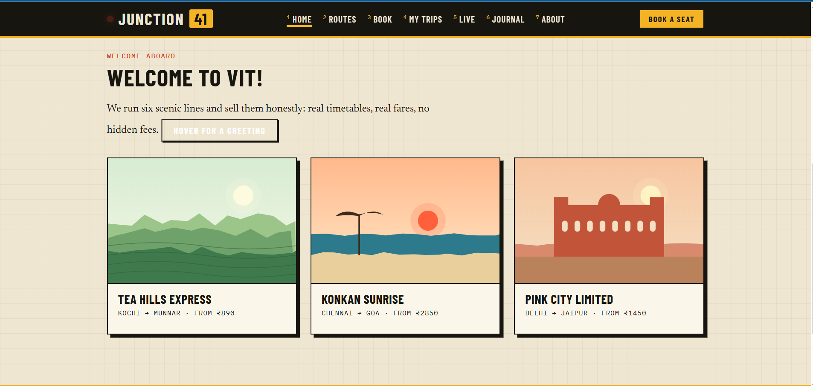
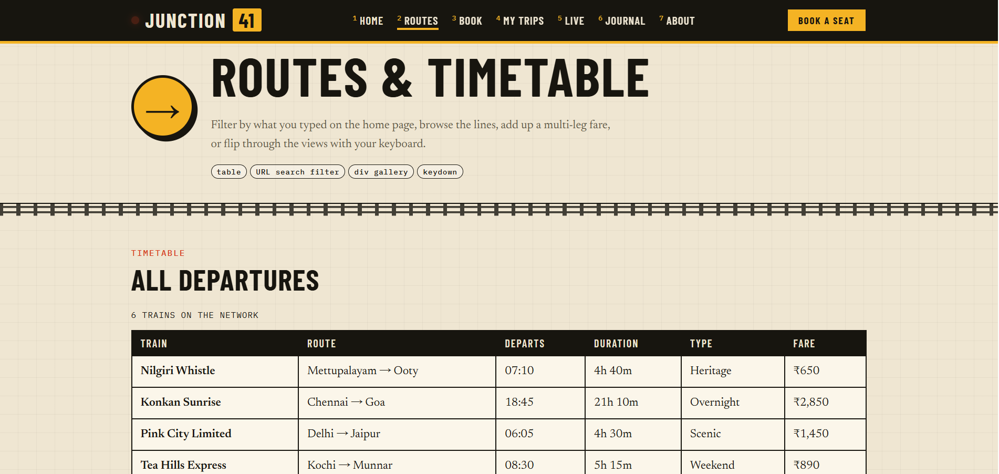
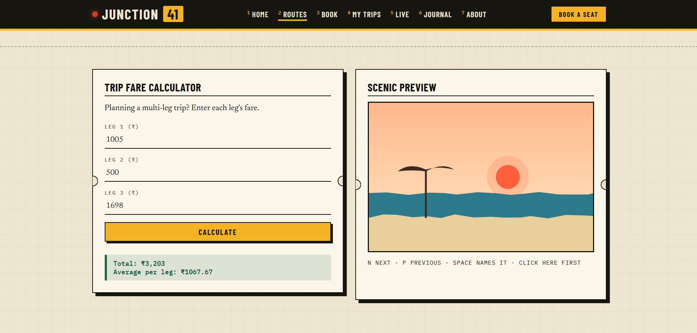
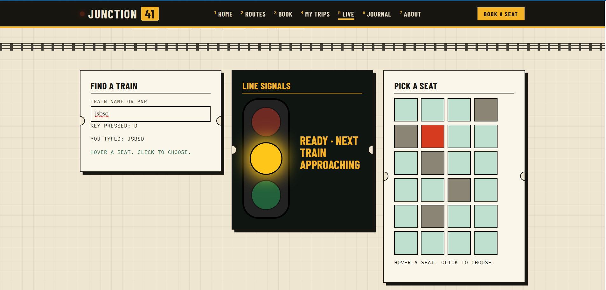
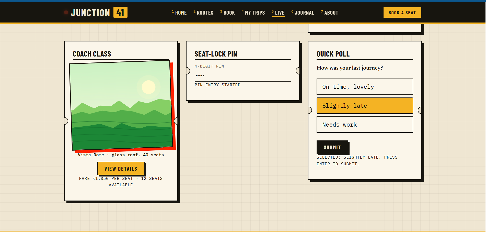

# Junction 41

A multi-page scenic-rail booking website built with plain **HTML5, CSS3 and JavaScript**. No frameworks, no build step.
It covers forms and regex validation, a booking and checkout flow, mouse and keyboard events, CSS grid, flexbox and multi-column layout, and embedded video and audio.

**Live demo:** `https://Priyansh252.github.io/Junction41/`  <!-- turn on GitHub Pages, then edit this link -->

## Screenshots

| | |
|---|---|
|  |  |
|  |  |
|  |  |

## Run it locally

**Quickest:** double-click `index.html`.

**With a local web server (recommended):**

```bash
cd junction41
python -m http.server 8000     # use python3 on Mac/Linux
```

Then open <http://localhost:8000>.

Other options: `npx serve .`, the VS Code *Live Server* extension, or XAMPP (copy the folder into `htdocs`).

## Pages and concepts

| Page | What it does | Concepts |
|---|---|---|
| `index.html` | Slider, search bar, featured routes | fixed header, 70vh slider, flexbox, mouseover / mouseout |
| `routes.html` | Timetable, gallery, fare calculator, photo viewer | tables, div gallery, URL filter, keydown |
| `book.html` → `payment.html` → `summary.html` | Three-step checkout | regex validation, arrays, DOM tables, sessionStorage |
| `trips.html` | Dashboard and boarding pass | div sidebar layout, table layout, colspan / rowspan |
| `status.html` | Live desk: search, signals, seat map, PIN, poll | mouse and keyboard events |
| `account.html` | Sign in | empty checks, regex, audio |
| `careers.html` | Staff registration | HTML5 validation, video |
| `assist.html` | Assistance request | every HTML5 input type, CSS grid |
| `fest.html` | Event registration | regex, arrays, result table, video and audio |
| `journal.html` | News page | CSS columns, media queries |
| `about.html` | About the service | nested lists, text formatting, sub / sup |

## Project structure

```
junction41/
├── *.html            13 pages
├── css/style.css     shared stylesheet
├── js/               small page scripts
├── img/              SVG artwork
├── media/            welcome.mp4, announcement.mp3
├── screenshots/      images used in this README
└── source/build.py   optional page generator
```


## Notes

- Fonts load from Google Fonts and fall back to system fonts when offline.
- Forms are demos: nothing is sent to a server.

## Author

Priyansh Mudela 
